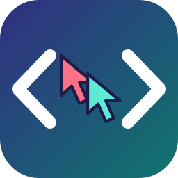

<p align="center"></p>

# Ferroshare

Real-time collaborative editing for VS Code with a self-hosted Rust relay.

- **Joining just works.** There are no accounts and no Microsoft service. Your relay speaks plain WebSocket on one port, and an invite link is all a friend needs.
- **Guests get your IntelliSense.** Completion, hover, go-to-definition, references, rename, signature help, formatting, semantic highlighting, inlay hints and diagnostics are answered by *your* VS Code, using your extensions: C# Dev Kit, clangd, TypeScript, Docker, Makefile and so on. Guests don't need anything installed.
- **Sync can't drift.** Every participant holds a CRDT replica (`yrs` in Rust, `Yjs` in the extension). Editors converge on it by diffing, and the daemons repair any lost update every few seconds.
- **Undo is per person.** Ctrl+Z undoes your own edits, never a friend's.
- **End-to-end encrypted.** The relay, and anything in front of it like Cloudflare, only ever sees ciphertext. See [Security](#security).

## Quick start

### 1. Run the relay (once, on a machine everyone can reach)

```sh
cargo build --release -p mls-relay
./target/release/mls-relay --listen 0.0.0.0:7777
```

- **Docker:** `docker run -d --restart unless-stopped -p 7777:7777 asgerveng/ferroshare-relay` runs the published image (amd64 and arm64). The image is small, has no shell, runs as a non-root user and needs no volumes, because the relay keeps no state.
  - With Compose: `docker compose up -d relay` pulls the same image. Uncomment `ports:` in `compose.yaml` to expose it on 7777, or use `docker compose build` to build it from source.
  - To run it behind a Cloudflare Tunnel instead, follow the steps at the top of `compose.yaml`: put `TUNNEL_TOKEN` in `.env`, then run `docker compose --profile tunnel up -d`.
- **Hosting from home:** forward TCP port 7777 on your router to the PC running the relay. Then use `ws://<your-public-ip>:7777`.
- **VPS:** run it there, for example as a systemd service, and use `ws://<vps-ip>:7777`.
- **Cloudflare Tunnel (no port forwarding, works on locked-down networks):** run the relay with `--listen 127.0.0.1:7777`, then:
  - Quick, throwaway URL: `cloudflared tunnel --url http://localhost:7777` prints `https://<random>.trycloudflare.com`. Use `wss://<random>.trycloudflare.com` as the relay URL. The URL changes every time cloudflared restarts.
  - Stable URL on your own domain (the domain's DNS must be managed by Cloudflare):
    ```sh
    cloudflared tunnel login                                  # pick your domain in the browser
    cloudflared tunnel create mls-relay
    cloudflared tunnel route dns mls-relay relay.example.com  # creates the DNS record
    cloudflared tunnel run --url http://localhost:7777 mls-relay
    ```
    Then use `wss://relay.example.com`. To start it with Windows, install it as a service (`cloudflared service install`) with a config file that contains the ingress rule `hostname: relay.example.com` → `service: http://localhost:7777`.
  - Cloudflare terminates TLS on port 443, so it gets through school and corporate firewalls. WebSockets are on by default for tunnels, and the daemon pings every 20s, which stays well inside Cloudflare's 100s idle timeout.
- **Own reverse proxy:** put it behind TLS on port 443 and use `wss://relay.example.com`. For example, with Caddy: `relay.example.com { reverse_proxy localhost:7777 }`.

### 2. Install the extension (host and friends)

```sh
cd extension
npm install
npm run package          # builds mls.exe in release mode and writes ferroshare.vsix
code --install-extension ferroshare.vsix
```

Send the `.vsix` to your friends. It contains everything a guest needs, with daemons for **Windows x64** and **Linux x64**. The Linux daemon is built in Docker as a static binary, so it runs on any distro; set `MLS_SKIP_LINUX=1` to skip it.

Mac or ARM Linux users can build the daemon themselves with `cargo build --release -p mls` and point `ferroshare.daemonPath` at `target/release/mls`.

### 3. Collaborate

- **Host:** set `ferroshare.relayUrl` to your relay's address. Open your project, click **Ferroshare** in the status bar and choose **Host session**. The invite link is copied to your clipboard.
- **Guest:** click **Ferroshare**, choose **Join session** and paste the link. A window opens with the host's project.
- **Status bar menu:** copy the invite, share a terminal, jump to a participant's cursor, end or leave the session.
- **Files:** guests can create, delete, rename and move files and folders from their explorer. The host's VS Code carries each change out, so the host's open editors and unsaved changes move along with a rename, and deletes go to the host's trash.
- **Shared terminals (host only):** **Share Terminal** starts a shell on the host machine in the shared folder, and it opens for everyone. The host picks:
  - **Read-only:** guests see the output but can't type.
  - **Read/write:** guests can type too, so **they can run any command on the host's computer, as the host**. Only do this with people you trust.

  Closing the tab on the host stops the terminal for everyone. Guests can close theirs and reopen it from the Ferroshare panel. People who join later see the recent output.

## Architecture

```
VS Code extension (TS)  ⇄ localhost JSON ⇄  mls daemon (Rust)  ⇄ WebSocket ⇄  mls-relay (Rust)
 - Yjs replica per open file                - yrs replicas, anti-entropy       - routes opaque frames
 - editor ⇄ CRDT binding                    - sandboxed workspace access       - sessions + secret tokens
 - IntelliSense bridge, cursors, undo        - guests reconnect automatically
```

| Path | What it is |
|---|---|
| `crates/mls-proto` | Wire protocol. The relay only understands routing; payloads are opaque to it. |
| `crates/mls-sync` | CRDT document store (UTF-16 offsets, matching VS Code). |
| `crates/mls-relay` | Self-hostable relay. |
| `crates/mls-daemon` | The `mls` binary: one per participant, started by the extension. It survives window reloads. |
| `extension/src/binding.ts` | Editor ⇄ CRDT sync, the part that fixes Live Share's sync bugs (see the comment at the top of the file). |
| `extension/src/lang.ts` | IntelliSense forwarding. The host only runs a fixed whitelist of language-feature commands. |

## Security

An invite link looks like `wss://relay.example.com#<session>.<token>.<key>`:

- **`session` and `token`** are sent to the relay, so it knows which session to put you in. The relay creates them, so it knows them anyway.
- **`key`** is a random 256-bit key generated by the host's daemon. It lives in the link's `#fragment` and is **never sent to the relay**.

Everything peers send each other (file contents, edits, file listings, cursors, IntelliSense requests and answers, diagnostics, saves) is sealed with XChaCha20-Poly1305 under that key (`crates/mls-daemon/src/crypto.rs`). Each message is bound to the session and to its sender, and carries a per-sender counter. So whoever runs the relay, or Cloudflare in front of it, **cannot**:

- read any code or file names,
- change or inject messages (they're dropped and logged),
- relabel who sent a message, or
- replay old messages, such as an old edit or a second save.

What the relay **can** still see and do:

- See who is connected and their display names, plus message sizes and timing.
- Drop or delay messages. Dropped edits are repaired by anti-entropy.
- End sessions.
- Join a session as an extra participant, because it knows the token. That participant shows up in the participant list but can't read or send anything.

Treat the invite link like a password: anyone who has the whole link can join and see the shared folder.

Guests can change files inside the shared folder (create, edit, delete, rename). The host's daemon checks every change against the same sandbox as reads: nothing outside the folder, nothing in `.git/`, and no following symlinks out. Deleted files go to the host's trash where the OS has one.

Terminals are never shared unless the host chooses to. A read-only terminal ignores guests' keystrokes in the host's daemon, not just in their editor. A read/write terminal gives guests a shell on the host machine.

## Tests

```sh
cargo test --workspace                 # protocol, CRDT, relay, sandbox, full host+guest daemon e2e
cd extension
npm test                               # sync algorithm, incl. randomized multi-peer race fuzzing
npm run test:vscode                    # real VS Code: one run as host, one run as guest
```

`test:vscode` downloads an isolated VS Code into `extension/.vscode-test/`.

## Known limitations

- **Not built yet:** port forwarding, shared debugging and code actions (quick fixes).
- **Changes made outside VS Code** on the host (e.g. `git checkout`, a build writing files) reach guests' explorers within about 5 seconds rather than instantly.
- **Renames by someone else:** if another participant renames a file you have open, your tab shows it as deleted. Reopen it under the new name.
- **Terminal size:** a shared terminal has the host's size. Guests with a narrower panel see full-screen programs (`vim`, `htop`) wrapped.
- **Duplicate results:** if a guest has their own extension for a language (TS/JS is built into VS Code), they see its results alongside the host's.
- **Host disconnects end the session.** If the host's connection to the relay drops, the session ends. Guests reconnect automatically and nothing they typed is lost.
- **What guests can read:** guests can read any file inside the shared folder except `.git/`. `.gitignore`d files are hidden from the explorer, but they can still be opened by exact path. Only share folders you're happy for your friends to see.
- **Unsaved changes on the host:** files edited only by guests show as unsaved on the host until someone saves.
- **Only the first workspace folder** is shared.
